<div align="center">

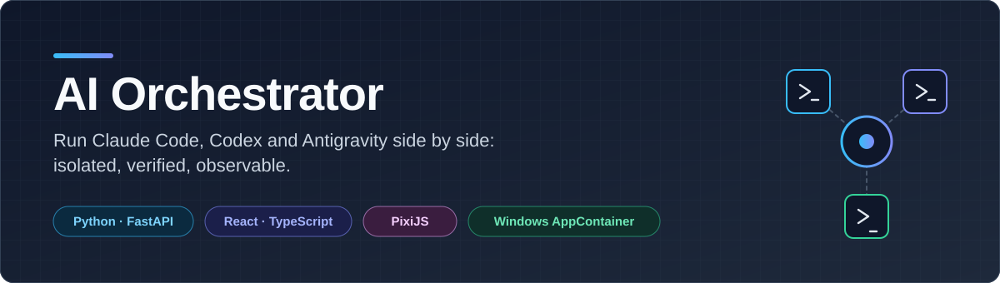

<br>


[](LICENSE)

[Features](#key-features) &middot;
[Demo](#live-demo) &middot;
[Architecture](#architecture) &middot;
[Security](#security-model) &middot;
[Quick start](#quick-start-windows) &middot;
[Usage](#how-to-use) &middot;
[Configuration](#configuration-reference) &middot;
[Testing](#testing) &middot;
[Roadmap](#roadmap)

</div>

---

AI Orchestrator is a local-first tool for Windows that coordinates the coding-agent CLIs you already use (Claude Code, OpenAI Codex and Google Antigravity) from one dashboard and one command line. You register a git project and describe a task. The orchestrator routes it to a suitable model, runs it in an isolated git worktree, and marks it complete only after deterministic verification passes. Everything runs on your machine, binds to `127.0.0.1`, keeps its state in SQLite outside the repository, and uses the subscription logins of the provider CLIs; no metered API is enabled by default.

## Why

Running several AI coding agents on one machine works until it does not: two agents edit the same checkout, a model says "done" while the tests fail, a quota runs out in the middle of a task, and nobody can say afterwards why a particular model was used or what it was allowed to touch.

AI Orchestrator exists to make that manageable on a single Windows PC:

- **Isolation.** Every task gets its own git worktree and branch, so agents never share a checkout and your main branch is never modified. Merging stays a manual git step.
- **Verification.** A model's claim of success is never enough. A task completes only with a stored passing verification record (commands and structured file checks), or with an explicit human approval that is recorded as such.
- **Approvals.** Risky steps (untrusted skill or MCP installs, permission escalation, high-risk tasks, leader-proposed commands) stop at a human gate.
- **Observability.** Routing decisions, state transitions, runs, checkpoints, usage and events are stored and visible, and "unknown" stays "unknown" when a provider does not report something.

## Key features

- **Task state machine and durable queue.** Thirteen explicit task states with an enforced transition table, SQLite persistence, checkpoints, retry and resume, and crash recovery that finds interrupted runs after a restart.
- **Per-task git worktrees.** One worktree and one `orch/<task id>` branch per task, in a separate directory outside your repository.
- **Deterministic routing with stored reasons.** Rules in `config/routing.yaml` pick a tier and required capabilities; the router resolves them to an available model and stores the candidates, scores and a human-readable reason for every decision. Quota or auth failures fall back to another suitable candidate and never to an unsuitable one. Adaptive adjustment is bounded and only applies after enough verified runs exist.
- **Leader and advisor roles.** One leader plans, decomposes objectives into tasks with dependencies and reviews results in bounded, schema-validated calls. An optional advisor gives independent second opinions that are stored as decision records. The leader can be switched with a validation step and rollback.
- **Provider adapters with discovery.** Claude Code, Codex and Antigravity behind one adapter contract, with installation, version, authentication and model discovery that never spends quota. Unsupported operations are reported, not faked.
- **Usage and analytics.** Usage states per provider and model, and analytics computed from recorded runs, with every metric labelled measured, estimated or missing.
- **Knowledge indexing.** SQLite FTS5 search over requirements, ADRs, docs, task summaries and error resolutions, with provenance and redaction before storage. Retrieved text is labelled as untrusted data.
- **Skills and MCP catalog.** A catalogue of skills and MCP servers. Fetching never checks out or executes anything, static inspection flags risky packages, and activation is project-scoped and requires an approval bound to the exact content.
- **Approvals.** A single queue of human gates with kind-specific detail, available in the dashboard and the CLI.
- **Verification pipeline.** Verify commands plus structured checks (`file_exists`, `contains`, `file_absent`, `file_unchanged`, `json_valid`), executed inside a per-command Windows sandbox (see [Security model](#security-model)).
- **Mission Control and Pixel Office.** A task board with live log, timeline, runs, checkpoints, diff, verification and artifacts, plus a PixiJS pixel-art office whose agents animate only from recorded events.
- **CLI and Windows launch scripts.** The `orchestrator` command line mirrors the dashboard; `scripts\start.cmd`, `scripts\stop.cmd` and `scripts\orchestrator.cmd` need no admin rights and no PowerShell script policy change.

## Live demo

<div align="center">
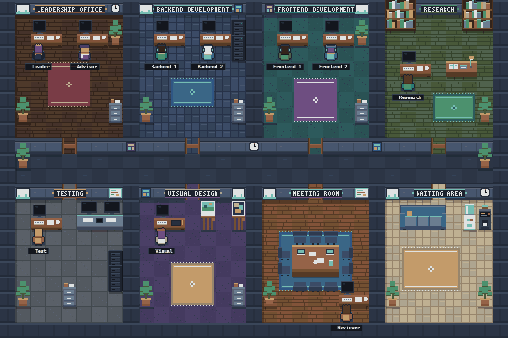
</div>

## Screenshots

<table>
  <tr>
    <td width="50%" valign="top">
      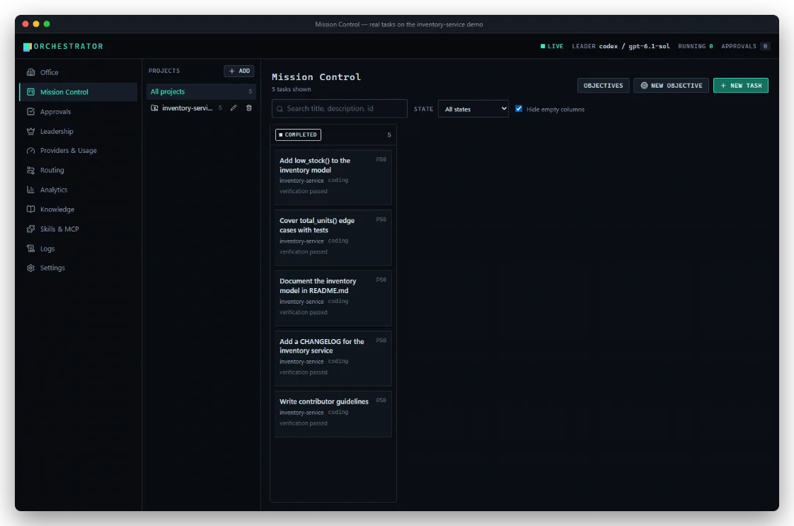
      <br><b>Mission Control.</b> Registered projects and the task board with one column per task state.
    </td>
    <td width="50%" valign="top">
      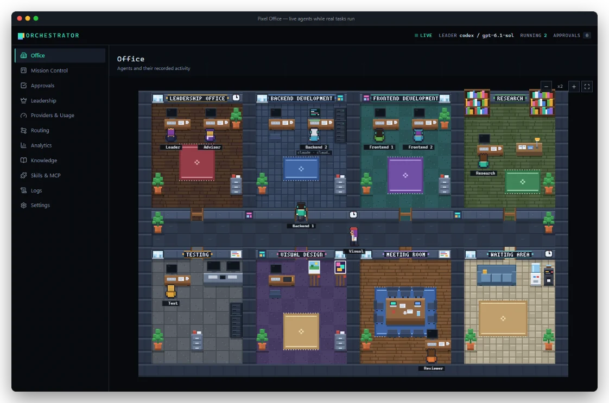
      <br><b>Pixel Office.</b> One seat per agent; the animation reflects recorded activity such as planning, coding, testing or waiting for approval.
    </td>
  </tr>
  <tr>
    <td width="50%" valign="top">
      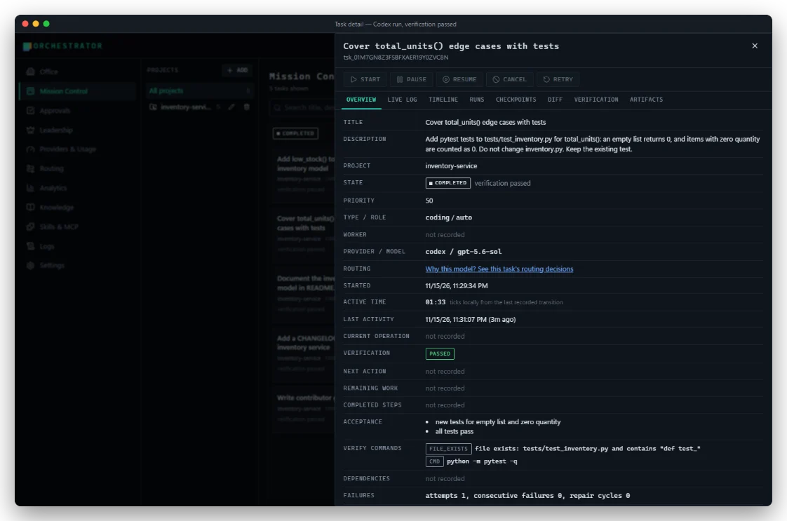
      <br><b>Task detail.</b> Overview, live log, timeline, runs, checkpoints, diff, verification records and artifacts for one task.
    </td>
    <td width="50%" valign="top">
      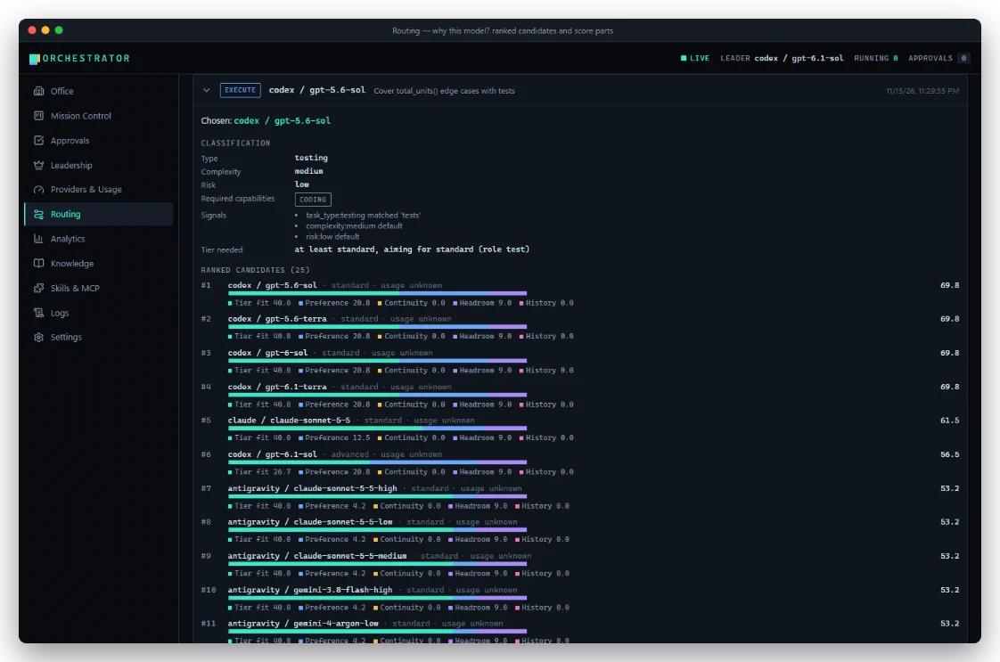
      <br><b>Routing.</b> Provider preferences, a routing preview, and the stored reasons, ranked candidates and rejections behind a past decision.
    </td>
  </tr>
  <tr>
    <td width="50%" valign="top">
      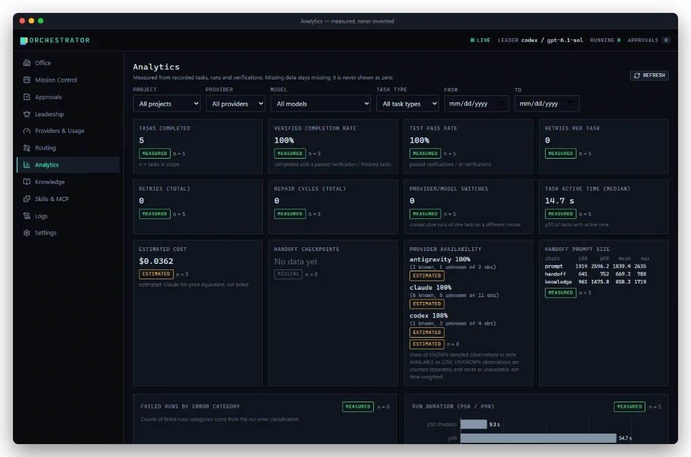
      <br><b>Analytics.</b> Completion and verification rates, retries, run durations and token usage, each with its exactness.
    </td>
    <td width="50%" valign="top">
      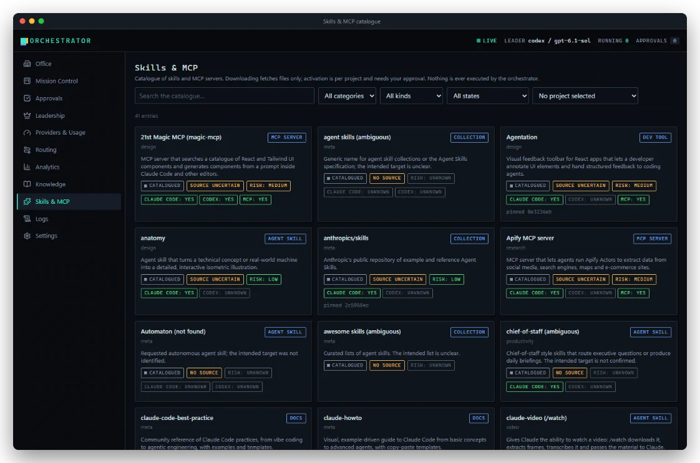
      <br><b>Skills &amp; MCP.</b> The catalogue with state, source and security findings, and approval-gated download and activation per project.
    </td>
  </tr>
  <tr>
    <td width="50%" valign="top">
      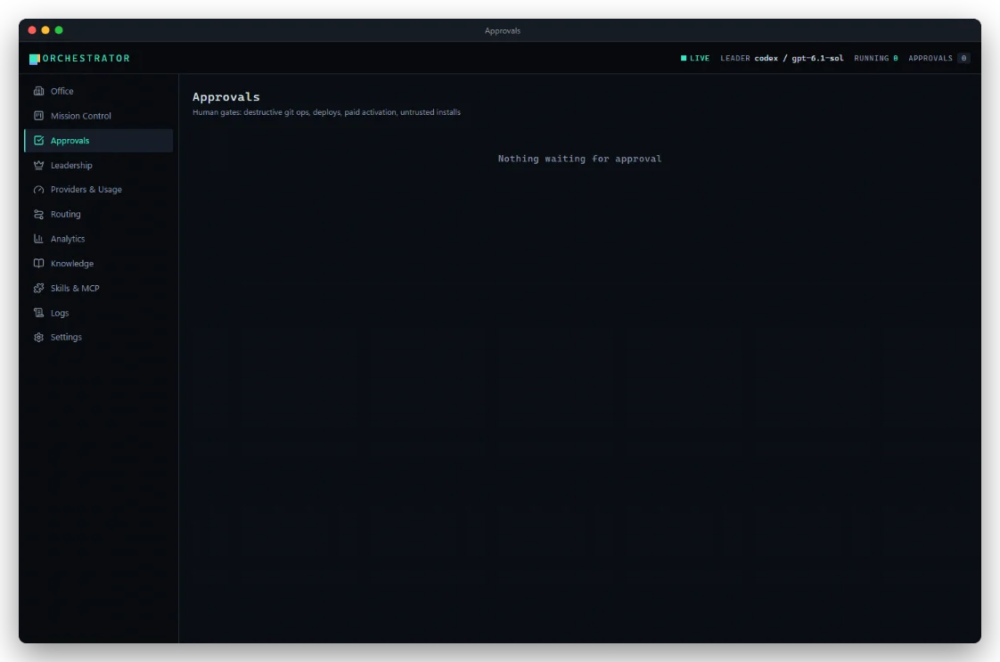
      <br><b>Approvals.</b> Pending human gates with what is being asked and what approving actually grants.
    </td>
    <td width="50%" valign="top">
      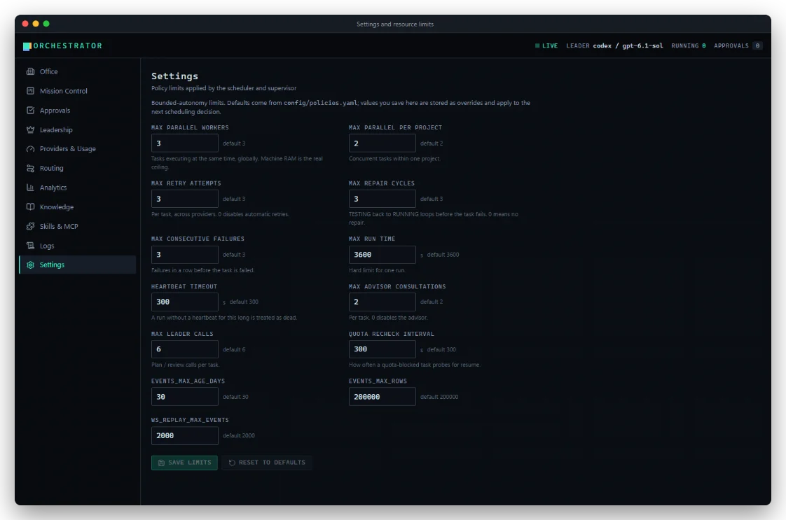
      <br><b>Settings.</b> Scheduler and supervisor limits such as parallel workers, retries, repair cycles and timeouts.
    </td>
  </tr>
</table>

## Architecture

The backend is a FastAPI application that owns a scheduler, a supervisor, an executor and a verifier. The dashboard talks to it over HTTP and a WebSocket event stream. Provider CLIs are child processes started through adapters; every agent and verification process runs inside a Windows Job Object.

### Components

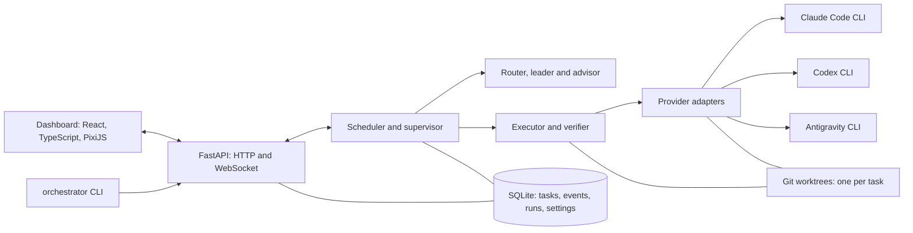

### Task lifecycle

The transition table lives in `backend/orchestrator/domain/states.py` and is enforced by the backend. The diagram shows the main path and the most important exits; `PAUSED` and `CANCELLED` are reachable from most active states and are omitted from the drawing for readability.

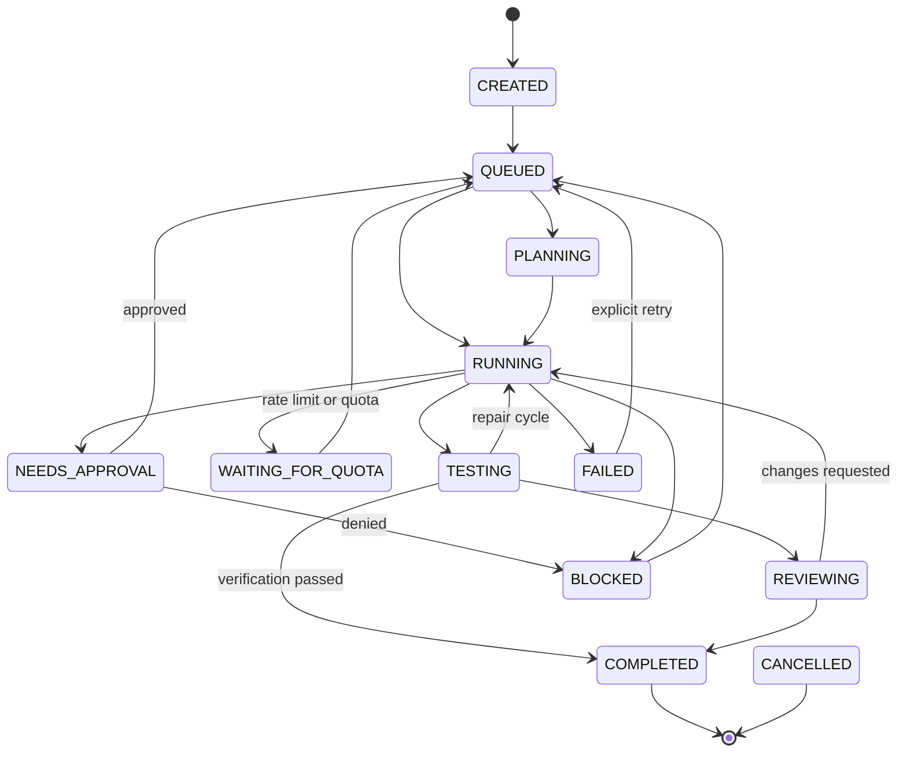

### Verification isolation

Verification commands never run in the task worktree. Each command runs in its own disposable copy under its own sandbox identity, and nothing is copied back.

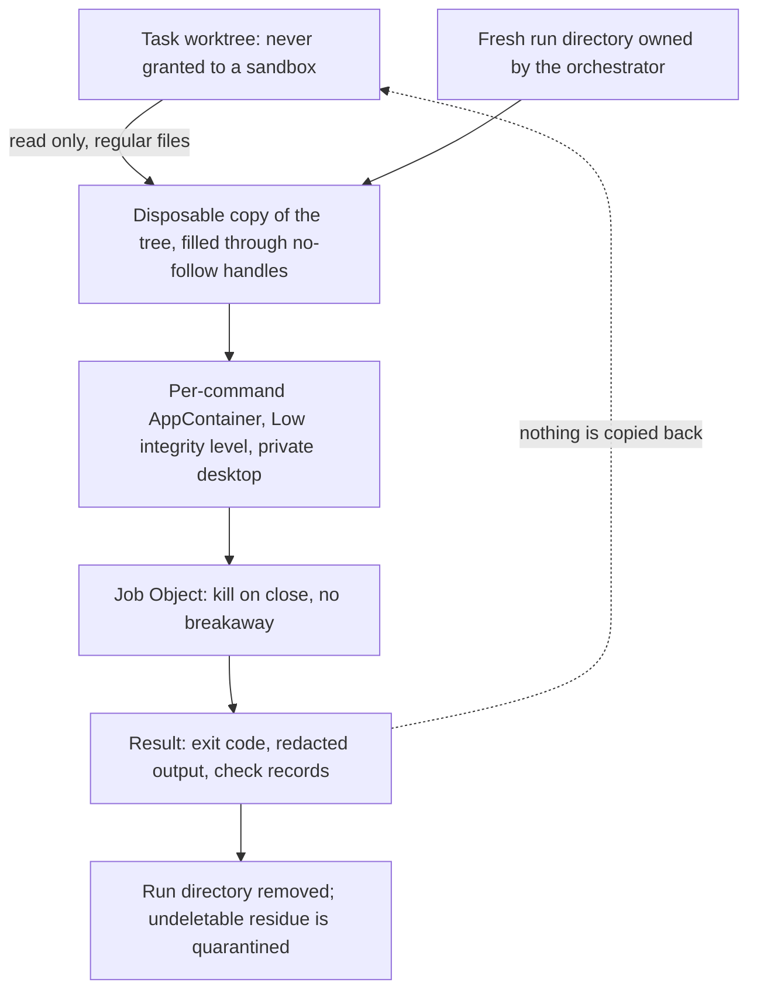

## Security model

AI Orchestrator is a **local, single-user tool**. It can start agents that edit files and run commands as your Windows user, so the security model is about keeping control of that capability and limiting what a misbehaving agent or verification command can reach. The full threat model, every control with its enforcing file and test, and the list of known weaknesses are in [docs/SECURITY.md](docs/SECURITY.md).

What is enforced:

- **Local only.** The server binds to loopback and refuses a non-loopback host unless an explicit flag is passed. Host and Origin headers are validated for HTTP and WebSocket, and every API route except the health check needs a random bearer token stored in an owner-only data directory.
- **Worker-origin guard.** Agents and verification commands run in a per-server Job Object, and the API refuses requests that originate from processes in that job, before authentication. An agent therefore cannot call the orchestrator's own API (for example to change approval policy).
- **Copy-in verification.** On Windows, verification runs in a per-command AppContainer with a Low integrity token inside a disposable copy of the worktree. If isolation cannot be established, the command is blocked; there is no unsandboxed fallback.
- **Codex activation gate.** Codex execution is refused until `orchestrator codex-attest` has run a set of model-free native containment checks against the installed Codex build and written an activation record. A Codex update or a change to the isolation code invalidates the record.
- **Approval gates, redaction, hardened git and subprocess handling.** Prompts go through stdin, git runs with hooks, filters and credential helpers disabled, child processes get an environment allowlist, and secret-shaped values are redacted from events, logs and verification output.

Provider confinement differs, and the differences are not hidden:

| Provider | What confines the agent | Not confined or not determined |
|---|---|---|
| Claude Code | Restricted mode with an explicit file-tool allowlist: no shell and no web tools by default; writes and reads outside the worktree were refused in testing | Opt-in `worker_permissions.claude_shell` adds a shell and removes confinement. Claude workers cannot run tests themselves; the verifier does |
| Codex | Orchestrator-owned runtime and `CODEX_HOME`, pinned configuration with named Windows sandbox profiles, empty MCP inventory, activation attestation | Codex still has a shell inside its sandbox; network reachability under the profile is not asserted; reads of locations not covered by the attestation checks are not claimed to be denied |
| Antigravity | `--mode` selection and `--disable-slash-commands`; headless shell commands are auto-denied by the CLI | Read confinement and workspace-configuration loading are **not determined**. Do not route sensitive write tasks to it |

What is **not** protected: malware or other processes already running as your Windows user, an administrator, a compromised provider vendor or CLI, and anything that can read the API token. The data directory is not encrypted. Pattern-based redaction cannot catch every secret format. A model can still follow hostile text it reads inside the permissions it was given. Verification residuals (standard AppContainer broker channels and system locations readable by all application packages) are listed in [docs/SECURITY.md](docs/SECURITY.md). Do not expose the port, do not run unattended on untrusted repositories, and keep `auto_approve` empty.

## Quick start (Windows)

Prerequisites (details in [docs/INSTALLATION.md](docs/INSTALLATION.md)):

- Windows 10 or 11
- [uv](https://docs.astral.sh/uv/getting-started/installation/), which provisions Python 3.12
- Node.js 22 LTS (with npm)
- Git for Windows
- At least one provider CLI installed and logged in: `claude`, `codex` or `agy`. The orchestrator only detects them; it never installs them and never stores your credentials. Without one, the dashboard and CLI work but no task can run on a real model.

Get the code and start:

```
git clone https://github.com/Emincanozen/Orchestrator-Control-Room.git
cd Orchestrator-Control-Room
scripts\start.cmd
```

On the first run this checks `uv` and Node, creates the Python environment (`uv sync`), builds the dashboard (`npm.cmd ci`, `npm.cmd run build`), starts the server in the background and opens the browser at `http://127.0.0.1:8765/`. The first start takes a few minutes; later starts take a few seconds. Stop it with:

```
scripts\stop.cmd
```

Check the setup locally without spending any quota:

```
scripts\orchestrator.cmd doctor
```

**Codex only: attest once.** Before any Codex task runs, execute:

```
scripts\orchestrator.cmd codex-attest
```

Codex execution is refused by design until this command has verified, with model-free native checks (named sandbox profiles, in-task writes allowed, sibling and owned-home access denied, untrusted project MCP not started, hardlink and junction handling), that the installed Codex build is contained as expected. It writes an activation record bound to the Codex version and package hash and to the isolation code, so re-run it after updating Codex. It sends no prompt and spends no quota. Claude and Antigravity do not need it.

In PowerShell, use `npm.cmd` and `npx.cmd`: the default execution policy blocks the `.ps1` shims. The scripts in `scripts\` are `.cmd` files and are not affected.

## How to use

1. **Register a project.** In Mission Control choose `Add project` and give a name, the absolute path of a git repository and optional default verify commands, or use the CLI: `scripts\orchestrator.cmd projects add shop D:\code\shop --verify-cmd "npm test"`. Registration refuses system and profile directories and the orchestrator's own directories.
2. **Create a task.** Use `New task` (title, description, acceptance criteria, verify commands, priority) or `scripts\orchestrator.cmd run --project <id> --title "Fix the login bug" --follow`. For larger goals create an objective and review the leader's decomposition before it creates tasks.
3. **Watch it run.** Mission Control shows each task moving through the board; the task detail has the live log, timeline, runs, checkpoints, diff and verification records. The Pixel Office shows the same activity as seated agents. Pause, resume, cancel and retry from the task detail or the CLI.
4. **Handle approvals.** When a task needs a human decision (an unverifiable completion, a permission escalation, a high-risk task, a skill install, leader-proposed commands), it moves to `NEEDS_APPROVAL` and appears in Approvals. Read what approving grants, then approve or deny.
5. **Merge manually.** Completed work is on the task's `orch/<task id>` branch. Review the diff and merge it yourself.

The full walkthrough, including leadership, routing, knowledge, skills and CLI equivalents, is in [docs/USER_GUIDE.md](docs/USER_GUIDE.md).

## How to extend

- **Add a provider adapter.** Implement `ProviderAdapter` from `backend/orchestrator/providers/base.py` (`detect`, `discover_models`, `execute`) and register it with `ProviderRegistry`. `execute` yields `AgentEvent` values and must end with a `RESULT` event; provider failures become a failed result with an `ErrorCategory`, never an exception. Adapters must use argument arrays, send the prompt on stdin, apply the recursion guard and the requested permission profile, and report unsupported operations through `ProviderCapabilities` instead of faking them. Existing adapters and the scripted mock provider are in `backend/orchestrator/providers/`; contract tests are in `backend/tests/contract/`. Add model tiers and capabilities to `config/models.yaml`.
- **Add verification.** Set default verify commands per project, or per task. Commands run as argument arrays in the sandbox described above. Structured checks (`file_exists`, `contains`, `file_absent`, `file_unchanged`, `json_valid`) run in the verifier without starting a process. Commands proposed by a leader pass through the safety filter in `backend/orchestrator/leader/safety.py` and anything outside its allowlist needs an approval.
- **Add skills and MCP servers.** Add entries to `config/skills-catalog.yaml`. Skills are fetched from GitHub sources without execution, inspected, and activated per project after an approval.
- **Change routing.** Edit `config/routing.yaml` (roles, task types, tier bumps, scoring weights, fallback) or use the Routing view for provider order and disabled models.

The module and API contract is in [docs/ARCHITECTURE.md](docs/ARCHITECTURE.md); decisions and their reasons are in [docs/ARCHITECTURE_DECISIONS.md](docs/ARCHITECTURE_DECISIONS.md).

## Configuration reference

Environment variables read by the backend and CLI:

| Variable | Purpose | Default |
|---|---|---|
| `ORCHESTRATOR_DATA_DIR` | Data directory (database, API token, logs, skills) | `%LOCALAPPDATA%\AI-Orchestrator` |
| `ORCHESTRATOR_WORKTREES_DIR` | Task worktrees directory; must not be inside or contain the data directory | `<data dir>-worktrees` |
| `ORCHESTRATOR_CONFIG_DIR` | Directory holding the `config/*.yaml` files | `config\` in the repository |
| `ORCHESTRATOR_URL` | Backend URL used by the CLI | derived from `security.bind_host` and `security.port` |
| `ORCHESTRATOR_TOKEN_FILE` | Token file path used by the CLI | `<data dir>\api-token` |
| `ORCHESTRATOR_HARDEN_ACL` | `0` disables the owner-only ACL hardening (used by tests) | enabled |
| `ORCHESTRATOR_DEV` | `1` enables `/docs`, `/redoc`, `/openapi.json` and the Vite dev origin (needed for `npm.cmd run dev`) | off |
| `ORCHESTRATOR_ENABLE_MOCK` | `1` registers the scripted mock provider | off |
| `ORCHESTRATOR_DISABLE_REAL_PROVIDERS` | `1` stops the real provider adapters from being built (tests) | off |
| `ORCHESTRATOR_NO_PAUSE` | Set to stop `scripts\start.cmd` from pausing on exit | unset |

`ORCHESTRATOR_*` variables are never passed to agent or verification child processes.

Policy files in `config/`:

| File | Top-level keys | Notes |
|---|---|---|
| `policies.yaml` | `limits`, `budgets`, `approvals`, `worker_permissions`, `security` | Scheduler limits (`max_parallel_workers`, `max_parallel_per_project`, `max_retry_attempts`, `max_repair_cycles`, ...), `approvals.required_for` and `auto_approve`, `worker_permissions.claude_shell` (YAML-only), `security.bind_host`, `security.port`, `security.allowed_origins`, `security.child_env_allowlist`. Limits can also be edited in the dashboard Settings view |
| `routing.yaml` | `roles`, `task_types`, `complexity_tier_bump`, `risk`, `scoring`, `adaptive`, `fallback`, `preferences` | Deterministic routing rules and weights; `adaptive.min_samples` gates adaptive adjustment |
| `models.yaml` | `providers` | Model tiers and capabilities that the CLIs do not report themselves |
| `skills-catalog.yaml` | `catalog_version`, `skills` | Seed catalogue of skills and MCP servers; nothing in it is installed by default |

## Testing

Backend tests use scripted mock providers by default, so they spend no quota and need no provider login:

```
cd backend
uv sync
uv run pytest -q
```

Opt-in smoke tests call the real provider CLIs with tiny prompts. They spend subscription quota and are deselected by default:

```
uv run pytest -q -m smoke
```

Frontend unit tests and end-to-end tests (Playwright, against the real backend with the mock provider):

```
cd frontend
npm.cmd install
npm.cmd run test
npm.cmd run build
npx.cmd playwright test
```

`npm.cmd run lint` runs the TypeScript check. The test strategy, the mapping from acceptance criteria to tests and how to run each level are in [docs/TEST_PLAN.md](docs/TEST_PLAN.md); recorded results and the evidence behind them are in [docs/VERIFICATION.md](docs/VERIFICATION.md).

## Repository layout

```
backend/orchestrator/   API, scheduler, providers, router, leader, knowledge, analytics, skills, security, CLI
backend/tests/          unit, contract, integration, recovery, security, router, leader, skills, knowledge, analytics, cli, smoke
frontend/src/           dashboard (React, Vite, Tailwind, PixiJS): views, store, office engine
frontend/e2e/           Playwright specs and the mock-provider test backend
config/                 policies.yaml, routing.yaml, models.yaml, skills-catalog.yaml
scripts/                start.cmd, stop.cmd, orchestrator.cmd, release tooling
docs/                   documentation and screenshots
```

Runtime data is not stored in the repository: see `ORCHESTRATOR_DATA_DIR` and `ORCHESTRATOR_WORKTREES_DIR` above.

## Documentation

| Document | Content |
|---|---|
| [docs/USER_GUIDE.md](docs/USER_GUIDE.md) | Using the dashboard and the CLI |
| [docs/INSTALLATION.md](docs/INSTALLATION.md) | Prerequisites, first start, data location, troubleshooting |
| [docs/PRD.md](docs/PRD.md) | Product requirements and acceptance criteria |
| [docs/ARCHITECTURE.md](docs/ARCHITECTURE.md) | Modules, data model, API, state machine |
| [docs/ARCHITECTURE_DECISIONS.md](docs/ARCHITECTURE_DECISIONS.md) | Architecture decision records |
| [docs/SECURITY.md](docs/SECURITY.md) | Threat model, enforced controls, known weaknesses |
| [docs/TEST_PLAN.md](docs/TEST_PLAN.md) | Test strategy and traceability |
| [docs/VERIFICATION.md](docs/VERIFICATION.md) | Verification evidence |
| [docs/ROADMAP_V5_1.md](docs/ROADMAP_V5_1.md) | Planned V5.1 work |

## Known limitations

- Single user, single Windows machine; the orchestrator only runs while the PC is on and the server is running.
- Provider confinement differs by provider; Antigravity's confinement is not determined (see [Security model](#security-model)).
- Antigravity cannot report its login state, and its headless mode auto-denies shell commands.
- Fallback to another provider after a real quota error is covered by tests with fake adapters.
- Adaptive routing needs a minimum number of verified runs per (provider, model, task type) before it changes any decision.
- Node verification currently requires the standard Program Files installation of Node.js, and dependency installation is not part of the verification sandbox: provision project dependencies beforehand.

## Roadmap

Planned work for V5.1 (an AI project architect, a model registry, a smarter router, a dynamic agent hierarchy, resource and budget governors, and an easy-install Windows distribution) is described in [docs/ROADMAP_V5_1.md](docs/ROADMAP_V5_1.md). It is planned, not implemented.

## License

Released under the [MIT License](LICENSE).
